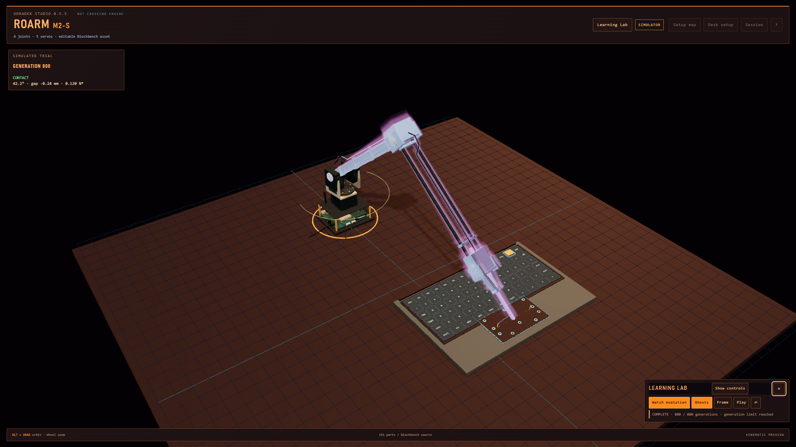

# Odradek Studio

A Windows desktop workbench for the Waveshare RoArm-M2-S, with a detailed 3D
replica, precise preview controls and an offline stylus-learning simulator.

**0.5.5 preview** brings the finished 0.5.4 app features into a curated Studio
distribution. Research records and development history are maintained separately.



## Install

Download the Windows x64 installer or portable ZIP from
[Releases](https://github.com/martinburstein/odradek-studio/releases).
Close other Odradek desktop editions before starting Studio; the editions use
the same local service ports. The per-user installer keeps its app and data
separate from the Lab edition. It creates shortcuts inside Desktop → Apps and
the Start menu, rather than loose desktop files.

- **Odradek Studio** opens the workbench in Manual.
- **Odradek Studio Learning Lab** opens the device-free learning view.
- For the ZIP, extract the entire folder and run `Odradek Studio.exe`.

The app includes Electron, Node and its local assets. Simulation needs no robot,
camera, Chrome, Python, Codex, Swarm, AI account or internet connection. The
Windows build is unsigned. A second-PC installation has not yet been verified.

## Watch the arm learn

Open Learning Lab, select **Revised corner practice**, then **Load included
study**. **Show iteration ghosts** overlays 82 saved best-policy generations as
translucent arms in the same 3D scene. Pink is earlier; cyan is later. The solid
arm shows the selected generation. Play/Pause, scrubbing and looping synchronize
the entire overlay. Hide controls for more scene space; Frame includes the ghost
motion; Ghost visibility adjusts transparency.

Four example runs are included. Every generation has a score, while selected
generations retain replayable policies. The Attempt selector can show saved
winners or worst candidates where available. No unsaved candidate poses are
invented. Train your own finite run, pause and save it, then export/import its
portable checkpoint to continue on another computer.

See the [Learning Lab guide](docs/LEARNING-LAB.md).

## Pose the replica

Click a joint and pull its arrow back. A longer pull makes a larger preview
turn. Release to animate, or enter exact angles. Alt-drag orbits; wheel zooms.
The gripper starts locked. Desk setup adjusts the laptop, trackpad and stylus
dimensions. The setup diagram is illustrative; measure your own arrangement.
Export a session to carry the pose, desk and edited Blockbench model together.

The six workspaces are Automatic, Manual, Sync View, Simulation, Live Camera
and Safety Check. Preview controls and offline rehearsals do not send physical
joint targets. Real device operation uses the existing local Controller and
requires separate device identification, qualification and current setup checks.
The simulator is usable immediately; hardware commissioning is not supplied by
an example session or installer. See [hardware scope](docs/HARDWARE.md).

## Edit and build

The [editable Blockbench model](assets/roarm/RoArm-M2-S.bbmodel) has embedded
textures and named joint groups. Edit it in Blockbench 5, preserve its hierarchy,
then load the edited model through Session. See [model details](docs/SIMULATOR.md).

To build on Windows, install Node **24.22.1** and Git, then run:

```powershell
npm ci
npm run prepare:app
npm test
npm run dist:win
node scripts/verify-learning-package.mjs release/win-unpacked
```

The installer and portable ZIP appear in `release/`. Dependency versions are
locked. `verify:sources` checks the curated component inventory; `verify:public`
rejects private development files and known machine-specific content.

## Model limits and licensing

The fixed taped tool has three positioning joints and no independent wrist.
Exact 45° pitch and exact planar position cannot be achieved everywhere.
Contact, compliance and `N*` load are model estimates. Physical pen pressure,
trackpad input and learned-policy execution on a real arm remain unvalidated.

Original code has no open-source license applied. Third-party components retain
their own licenses; see [notices](THIRD-PARTY-NOTICES.md). This project is an
independent workbench, not a Waveshare product or endorsement.
